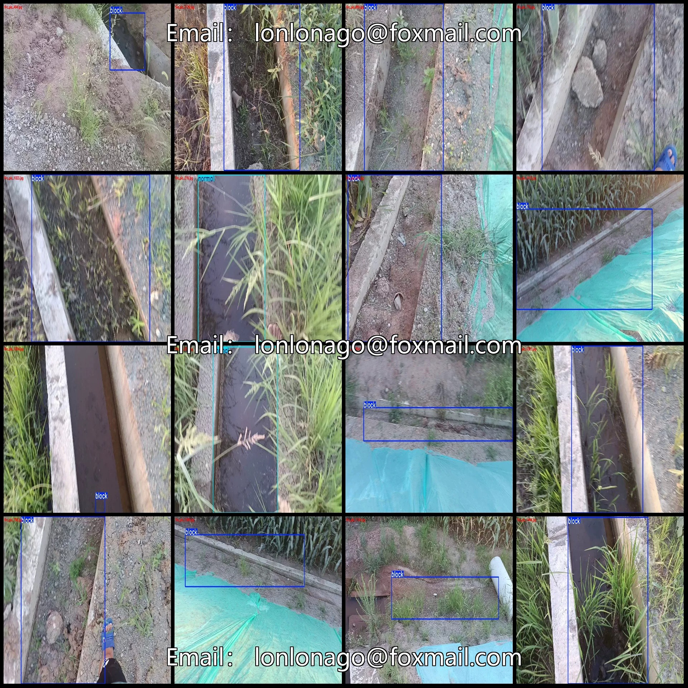
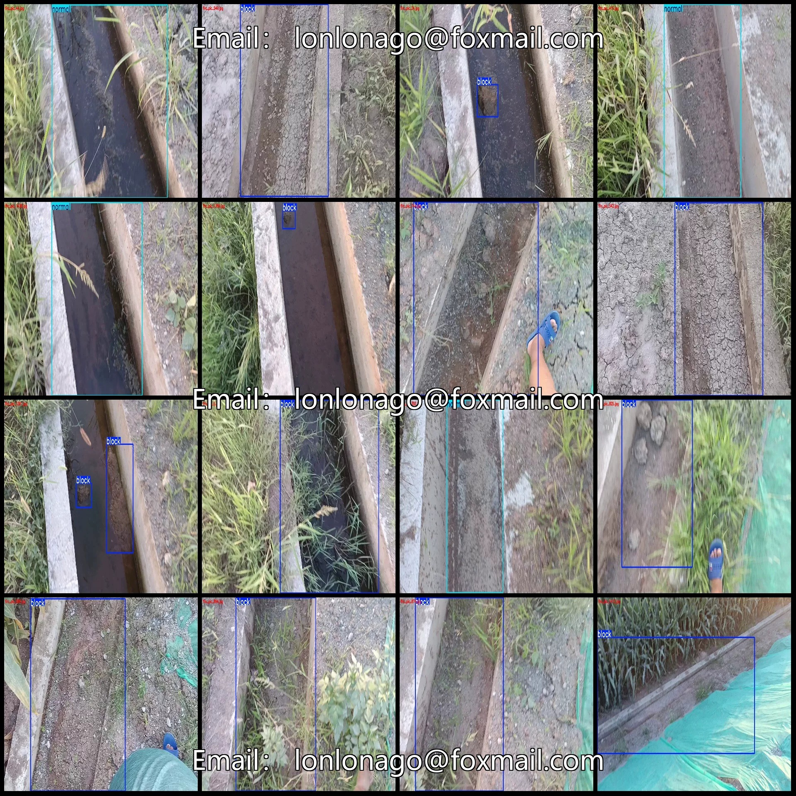
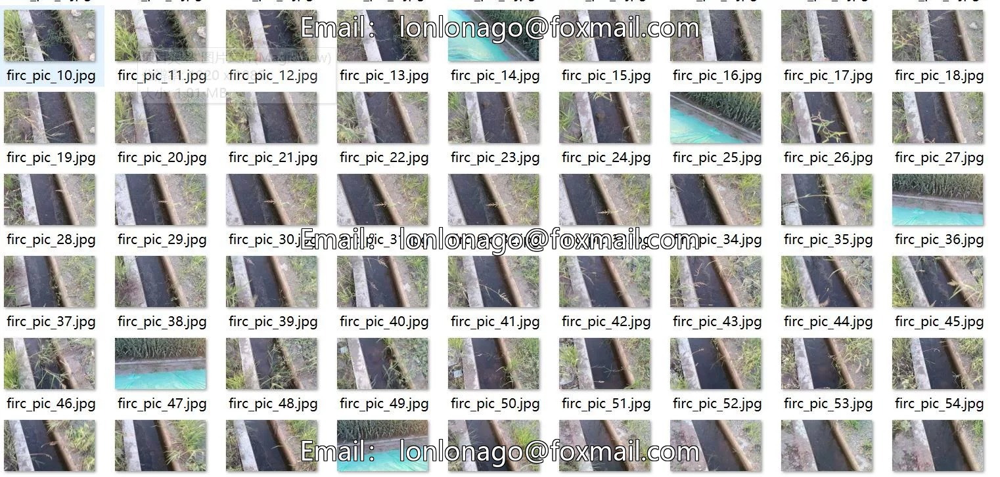
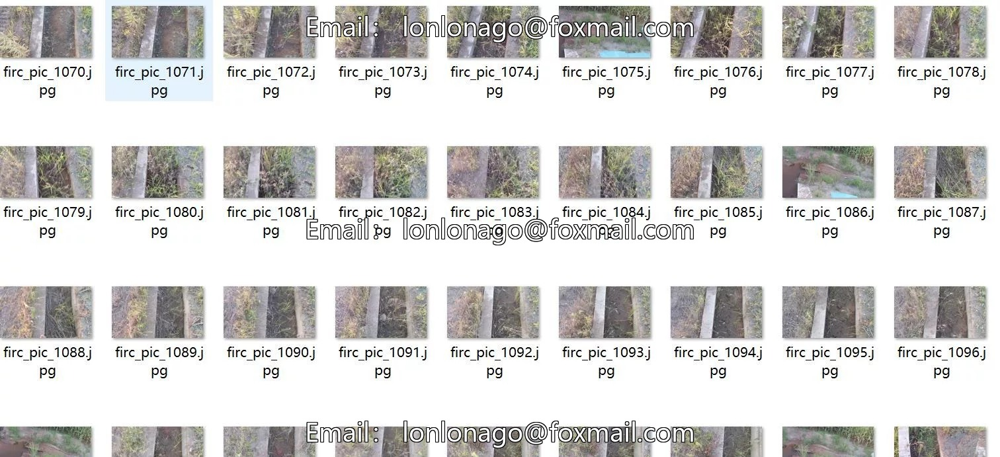

# Drone-view roadside slope drainage ditch blockage detection dataset VOC

## Body

Drone Viewpoint Roadside Slope Drainage Channel Obstruction and Mud Accumulation Detection Dataset VOC+YOLO Format: 1488 Images in 2 Categories
Tips: Due to the dataset's replicability, please confirm compliance with requirements before purchasing.
Dataset format: Pascal VOC format + YOLO format (excluding the split path's txt file, only containing jpg images along with corresponding VOC format xml files and yolo format txt files.)
Number of images (number of jpg files): 1488
Number of annotations (number of xml files): 1488
Number of annotations (number of txt files): 1488
Number of annotation categories: 2

Annotation Category Names (Note that the order of categories in the yolo format does not correspond to this, but is based on the classes.txt file in the labels folder): ["block", "normal"]
Number of boxes per category
Block (blockage/stagnation) = 1328
Normal (normal) = 295
Total number of boxes: 1623
Number of images per category
Block = 1193
Normal = 295
Image resolution: 1920x1080
Labeling tool used: labelImg
Drone: DJI MAVIC 3
Collection height: 2-3m
Collection angle: 60~90°

Annotation rules: Draw a rectangle around the category.
Important Notice: The dataset does not have separate training, validation, and test sets; you need to partition them yourself.
Special : This dataset does not guarantee the accuracy of the trained models or weight files.

## Images

## Payment

Here is a pay link on Stripe ( https://buy.stripe.com/3cs8yP7sY87d0vu9AB ). Please contact me lonlonago@foxmail.com after funding $89, and I will send you a complete data files , thank you!

